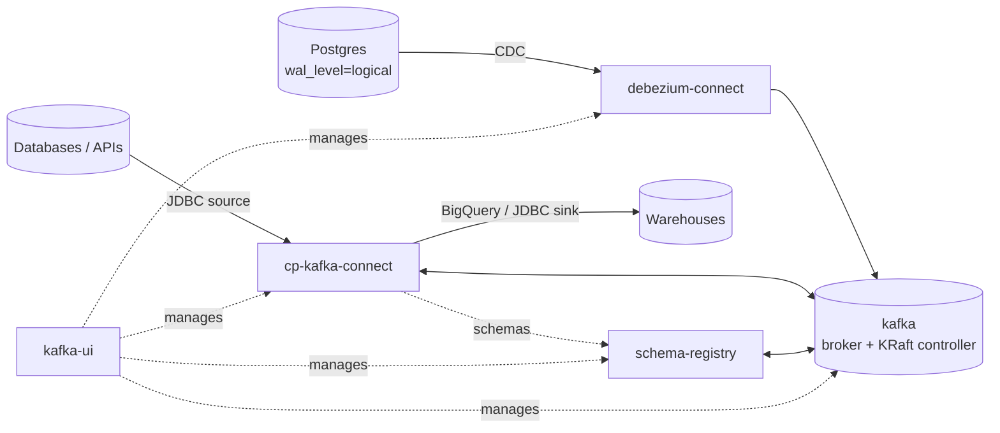

# Kafka - Architecture

Streaming and change-data-capture (CDC) stack: a single Kafka broker running in **KRaft mode** (no ZooKeeper), a Schema Registry, two Kafka Connect clusters (Confluent connectors and Debezium CDC) and a web UI.

## Components

| Service | Image | Role | In-network address |
| --- | --- | --- | --- |
| `kafka` | `confluentinc/cp-kafka:7.6.1` | Broker **and** KRaft controller (combined mode) | `kafka:29092` |
| `kafka-schema-registry` | `confluentinc/cp-schema-registry:7.6.1` | Avro / Protobuf / JSON schemas, stored in Kafka | `http://kafka-schema-registry:8081` |
| `cp-kafka-connect` | built from `connectors/cp-kafka-connect` | Confluent Connect: JDBC source/sink, BigQuery sink, Avro + Protobuf converters | `http://cp-kafka-connect:8083` |
| `debezium-connect` | `quay.io/debezium/connect:3.6.3.Final` | Debezium CDC (Postgres via `pgoutput`) | `http://debezium-connect:8083` |
| `kafka-ui` | `ghcr.io/kafbat/kafka-ui:v1.5.0` | Topics, consumer groups, schemas **and connectors on both Connect clusters** | `http://kafka-ui:8080` |

Host ports come from the root [`ports.env`](../../../ports.env) (`KAFKA_*_HOST_PORT`, `DEBEZIUM_CONNECT_HOST_PORT`); `make ports` lists them.



## Listeners

| Listener | Bind | Advertised as | Used by |
| --- | --- | --- | --- |
| `PLAINTEXT` | `0.0.0.0:29092` | `kafka:29092` | everything inside `data-ops-network` |
| `PLAINTEXT_HOST` | `0.0.0.0:9092` | `localhost:${KAFKA_HOST_PORT}` (prod: `${KAFKA_ADVERTISED_HOST}`) | clients on the host / outside Docker |
| `CONTROLLER` | `0.0.0.0:29093` | not advertised, not published | KRaft quorum traffic only |

The advertised host port must equal the published one, which is why both read `KAFKA_HOST_PORT`.

## KRaft

- **Combined mode**: node `1` is both broker and the only controller (`KAFKA_PROCESS_ROLES=broker,controller`, `KAFKA_CONTROLLER_QUORUM_VOTERS=1@kafka:29093`). Kafka 4.0 removed ZooKeeper support, so this is also the upgrade path.
- **Cluster identity**: `CLUSTER_ID` is fixed in the base compose file and formats the `kafka-data` volume on first start. Changing it (or moving to a new cluster) needs a fresh `kafka-data` volume.
- **Replication**: every replication factor is `1` (broker, internal topics, Schema Registry, both Connect clusters) to match the single node. Raise them together if brokers are added.
- **Scaling out**: add nodes with their own `KAFKA_NODE_ID`, list them in `KAFKA_CONTROLLER_QUORUM_VOTERS` (3 controllers for a fault-tolerant quorum), then raise the replication factors.

## Connect clusters

| | `cp-kafka-connect` | `debezium-connect` |
| --- | --- | --- |
| Purpose | Generic integration (JDBC, BigQuery) | Log-based CDC from Postgres |
| Plugins | Installed at image build from Confluent Hub (see its `Dockerfile`) | Bundled in the Debezium image |
| Connector configs | `connectors/cp-kafka-connect/configs/{source,sink}/<system>/<database>/` | `connectors/debezium-connect/configs/cdc/<system>/<database>/` |
| Internal topics | `_cp-kafka-connect-*-storage` | `debezium-connect-*-storage` |

### Connector configs as code

- **Layout:** `connectors/<cluster>/configs/<direction>/<system>/<database>/<table>-<format>.json`
  - `direction`: `source` / `sink` (cp-kafka-connect), `cdc` (debezium-connect)
  - `system`: `postgres`, `mysql`, `bigquery`, `clickhouse`, ... (lowercase)
  - `database`: whatever the system calls its schema container - Postgres/MySQL/ClickHouse database, BigQuery dataset
  - `format`: `json` / `avro` / `protobuf`; the extension is always `.json` (the file is a JSON document)
  - Folders only exist once they hold a file.

  ```
  cp-kafka-connect/configs/source/postgres/users/customers-json.json
  cp-kafka-connect/configs/sink/bigquery/kafka_dataset/customers-avro.json
  debezium-connect/configs/cdc/postgres/users/customers-json.json
  ```
- **Naming:** the connector `"name"` is derived from the path - `<system>-<database>-<table>-<direction>-<format>` (e.g. `postgres-users-customers-source-json`) - and the apply script refuses files where it doesn't match. The format suffix keeps names unique when several variants run on the same cluster.
- **Apply:** `make kafka-connectors-apply [CLUSTER=cp-kafka-connect|debezium-connect] [DIRECTION=source|sink|cdc] [SYSTEM=...] [DATABASE=...] [FORMAT=json|avro|protobuf] [DRY_RUN=1]` sends each matching file with `PUT /connectors/<name>/config` (creates or updates, safe to re-run) and prints connector/task state. E.g. `make kafka-connectors-apply SYSTEM=clickhouse DIRECTION=sink`. The folder is the source of truth; kafka-ui is for inspecting and pausing.
- **Secrets:** configs never contain credentials. They use `${env:PG_SOURCE_USER}` / `${env:PG_SOURCE_PASSWORD}`, resolved by each worker's `EnvVarConfigProvider` from its environment (set from the root `.env`). The REST API and kafka-ui only ever show the placeholder.
- **Debezium:** each variant needs its own `slot.name` and `topic.prefix` (one replication slot can only feed one connector). Registering a Debezium connector creates a replication slot in Postgres that retains WAL until it's consumed - delete the connector *and* drop the slot (`SELECT pg_drop_replication_slot('<slot>')`) when you're done. Debezium relies on Postgres running with `wal_level=logical`, which the postgres stack sets.

## Dev vs prod

| | dev | prod |
| --- | --- | --- |
| Restart | `no` | `always` (kafka-ui: off) |
| kafka-ui | on | disabled (`profiles: ["tools"]`) |
| Advertised host | `localhost` | `KAFKA_ADVERTISED_HOST` (required) |
| Topic auto-creation | on | off - create topics explicitly |
| Retention | broker default | `KAFKA_LOG_RETENTION_HOURS` (default 168h) |
| Limits / log rotation | - | CPU/memory limits, 100 MB x 10 logs |

## Operating it

```sh
make kafka-dev-up        # broker, registry, Connect clusters, UI
make kafka-dev-topics    # list topics
make kafka-dev-logs
make kafka-help          # every target
```

Start Postgres first if you use either Connect cluster (the root compose declares that dependency; standalone, start it yourself). Open TODOs for this stack (K9 Avro on Debezium, K10 ClickHouse sink instead of BigQuery) are tracked in the repo's [`docs/architecture.md`](../../../docs/architecture.md).
