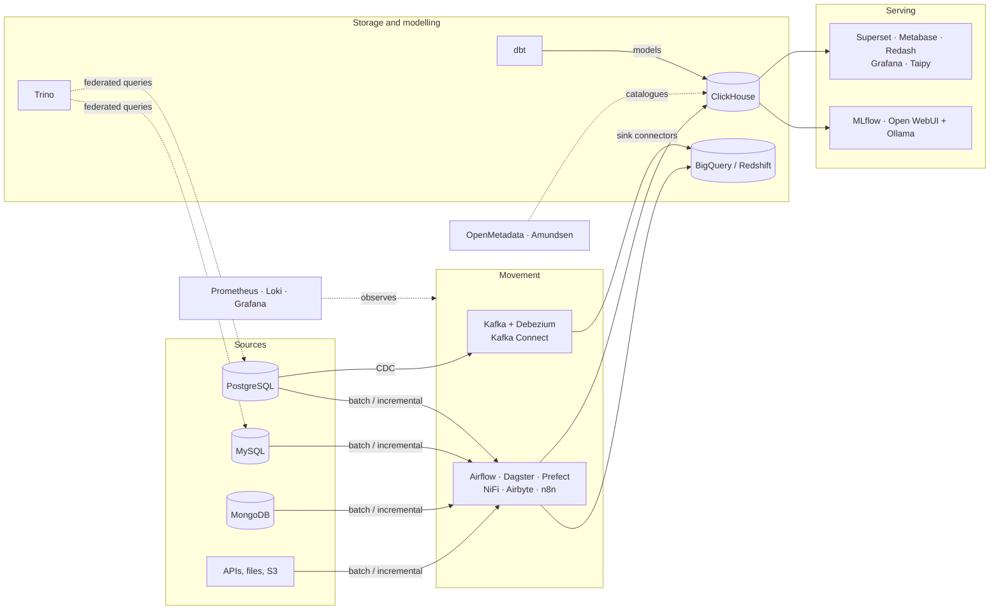

# Data-Ops Lab

**An open-source data platform I build, run and break on purpose — to evaluate data tooling hands-on before trusting it in production.**

This monorepo is my personal open-source project and working lab. I use it to test ideas, learn new technologies, and compare open-source data tools side by side on the same data, so that tool choices rest on hands-on evidence rather than vendor claims. Everything runs locally in Docker, and each tool is wired up the way it would be in a real deployment (separate dev and prod configuration, secrets kept out of the code, health checks, pinned versions).

- **Since:** April 2024 · **1,000+ commits** · actively maintained
- **Scope:** 50+ containerised services across 25+ stacks, covering ingestion, streaming/CDC, storage, transformation, orchestration, BI, monitoring, metadata and ML/AI
- **Monorepo, not monolith:** every stack can be lifted out and deployed on its own with its production config ([see how](#take-any-service-and-deploy-it-on-its-own))
- **Author:** [Rodgers Nyangweso](https://github.com/nyangweso-rodgers)

---

## What's inside

| Layer | Implemented (runs in this repo) | Explored (notes only, for now) |
| --- | --- | --- |
| **Databases** | PostgreSQL, MySQL, MongoDB, Redis, Elasticsearch + Kibana, Neo4j, Trino (federated SQL) | — |
| **Streaming & CDC** | Apache Kafka, Schema Registry, Kafka Connect, Debezium (Postgres CDC) | Redpanda |
| **Data warehouse** | ClickHouse | — |
| **Orchestration & data movement** | Apache Airflow, Dagster, Prefect, n8n, Apache NiFi, Airbyte | Temporal, Maestro, PeerDB |
| **Transformation & compute** | dbt (run from Airflow) | Spark |
| **BI & dashboards** | Superset, Metabase, Redash, Grafana, Taipy, Svelte + FastAPI live dashboard | Streamlit |
| **Monitoring** | Prometheus, Loki, Grafana, Postgres exporter | — |
| **Metadata & catalog** | OpenMetadata, Amundsen | — |
| **ML / AI** | MLflow, OCR pipeline, diabetes-prediction API, Open WebUI + Ollama (local LLMs) | MCP servers |
| **Apps & APIs** | Express.js APIs (Postgres, MongoDB), Flask API, Next.js web portal & survey app | — |
| **Docs** | Docusaurus site | — |

## How the pieces fit



## Highlights worth a look

- **Config-driven pipelines on Airflow** ([`workflows/airflow`](workflows/airflow)) — ingestion, reverse ETL and API syncs defined in YAML and generated into DAGs by a factory, with dbt projects running in their own isolated environment (dbt and Airflow have conflicting dependencies, so they don't share one).
- **A Dagster asset library** ([`workflows/dagster`](workflows/dagster)) — ingestion into ClickHouse from MySQL, Postgres, MongoDB and S3, plus exports to BigQuery, Redshift, S3 and more, deployable to AWS (ECS run launcher, S3 compute logs).
- **Change data capture** ([`03_messaging_services/kafka`](03_messaging_services/kafka)) — Debezium and Kafka Connect streaming Postgres changes through Kafka with Schema Registry (JSON / Avro).
- **BI tools compared on the same data** ([`07_dashboards`](07_dashboards)) — Superset, Metabase, Redash and Grafana side by side. Database connections and dashboards are provisioned from code rather than clicked together, and Metabase query caching is tuned to cut warehouse cost.
- **Local AI** ([`ai/open-webui`](ai/open-webui), [`ml-models`](ml-models)) — local LLMs via Ollama + Open WebUI, MLflow experiment tracking, an OCR pipeline and a model served as an API.

## How the repo is engineered

The repo is also an exercise in running many tools consistently. The same conventions apply everywhere:

- **Dev / prod configuration** — every stack has `docker-compose-<stack>.base.yml` plus `.dev.yml` and `.prod.yml` overrides. Prod points metadata databases at AWS RDS and artifacts at S3, refuses to start without required secrets, and adds restart policies, resource limits and log rotation.
- **One command per stack** — `make <stack>-dev-up`, `make <stack>-prod-up`, `make <stack>-logs`, … from the repo root (`make help` lists everything).
- **One registry for ports** — every published port is defined once in [`ports.env`](ports.env); compose files have no fallbacks, so a missing entry fails fast. `make ports` lists every port and fails on clashes.
- **Official images first** — services run the official images configured through compose; a Dockerfile exists only where the image itself must change (plugins, drivers, or my own code).
- **Reproducible Python** — each Python service has its own `pyproject.toml` + `uv.lock` (managed with [uv](https://docs.astral.sh/uv/)), deliberately kept as separate resolutions because Airflow, Dagster and Prefect pin incompatible versions of shared libraries.

Design decisions and the open TODO list for each service live in [`docs/architecture.md`](docs/architecture.md).

## Take any service and deploy it on its own

Living in a monorepo doesn't tie a service to the rest of it. Each stack folder (`workflows/dagster`, `07_dashboards/04_metabase`, `01-databases/01-postgres`, …) is a self-contained deployable unit: its own compose files, Makefile, Dockerfile (if any) and, for Python services, `pyproject.toml` + `uv.lock`. Its `docker-compose-<stack>.prod.yml` is a real production config: metadata databases on AWS RDS, artifacts on S3, required secrets, restart policies, resource limits and log rotation. So an extracted service doesn't need the rest of this repo running next to it.

To lift one out, e.g. Dagster:

```sh
mkdir -p ~/deploy/services
cp -r workflows/dagster ~/deploy/services/dagster
cp .env ports.env ~/deploy/            # keep the env files two levels above the stack
                                       # (trim .env to the variables the stack uses)
docker network create data-ops-network # or rename the network in the base file

cd ~/deploy/services/dagster
make prod-up                           # = base + prod compose files
```

The only things a stack shares with the repo are the two env files and the Docker network. Services it depends on at runtime (e.g. a database) are listed per stack in [`docs/architecture.md`](docs/architecture.md#services); in production those are managed services (RDS, S3) configured through `.env`.

## Quick start

Prerequisites: Docker (with Compose), `make`, and [uv](https://docs.astral.sh/uv/) for the Python tooling.

```sh
git clone https://github.com/nyangweso-rodgers/data-ops.git
cd data-ops
cp .env.example .env                       # fill in credentials

docker network create data-ops-network     # shared by every stack
docker volume create postgres-data         # the databases keep their data in named volumes

make postgres-dev-up                       # start Postgres
make metabase-dev-up                       # ...then any stack that uses it
make ports                                 # where is everything published?
make help                                  # all available commands
```

Each stack can run on its own; start the databases a stack depends on first (noted at the top of each `.dev.yml`).

## Repository layout

```
01-databases/            Postgres, MySQL, MongoDB, Redis, Elasticsearch, Neo4j, Trino
02_apis/                 Express.js and Flask APIs
03_messaging_services/   Kafka, Schema Registry, Kafka Connect, Debezium
05_data_processing/      Transformation & compute: dbt, Spark (notes)
06_data_warehouse/       ClickHouse
07_dashboards/           Superset, Metabase, Redash, Grafana stack, Taipy, Svelte + FastAPI
ai/                      Open WebUI + Ollama
metadata/                OpenMetadata, Amundsen
ml-models/               MLflow, OCR pipeline, prediction APIs
monitoring-and-observability/   Prometheus and Loki configuration
workflows/               Orchestration & data movement: Airflow, Dagster, Prefect, n8n, NiFi, Airbyte (+ PeerDB, Temporal notes)
10_documentation/        Docusaurus site
docs/                    Architecture notes and the TODO backlog
docker-compose.yml       Root compose (extends every stack's base file)
ports.env                Host port registry
Makefile                 Entry point for everything
```

## Status

This is a lab, not a production system: some stacks are battle-tested locally, others are mid-evaluation, and every open issue is tracked in [`docs/architecture.md`](docs/architecture.md). Breaking things here is how I learn what to trust elsewhere.

## Related notes

1. [Docker commands](https://github.com/nyangweso-rodgers/My-Journey-Into-Computer-Science/blob/master/04-VMs-vs-Containers/02-Containers/01-Docker/01-Docker-Commands/Readme.md)
2. [Docker Compose files](https://github.com/nyangweso-rodgers/My-Journey-Into-Computer-Science/blob/master/04-VMs-vs-Containers/02-Containers/01-Docker/02-Docker-Compose-File/Readme.md)
3. [Setting up an Express.js development environment](https://github.com/nyangweso-rodgers/Programming-with-JavaScript/blob/main/03-JavaScript-Frameworks/02-Express.js/01-Setting-Express-Development-Environment/Readme.md)
4. [Data streaming from PostgreSQL to BigQuery with Kafka Connect and Debezium](https://mohamed-dhaoui.medium.com/data-streaming-journey-moving-from-postgresql-to-bigquery-with-kafka-connect-and-debezium-2679fdbbffd0)
5. [Debezium documentation](https://debezium.io/documentation/reference/stable/tutorial.html)
